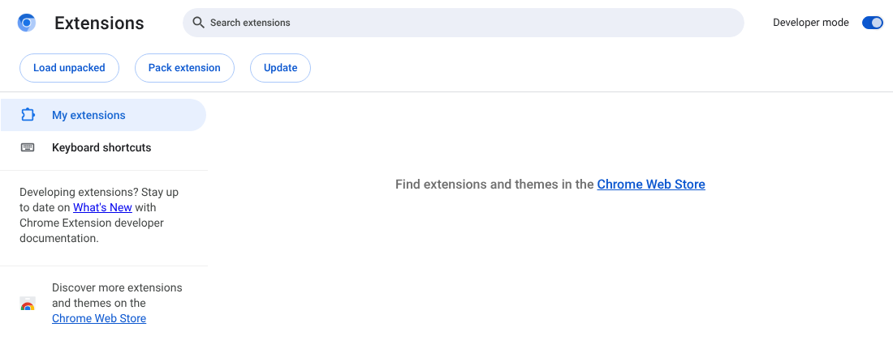
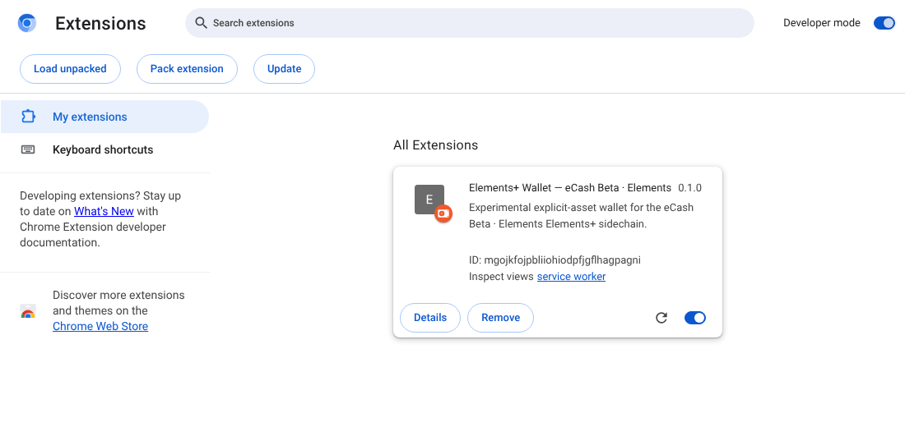
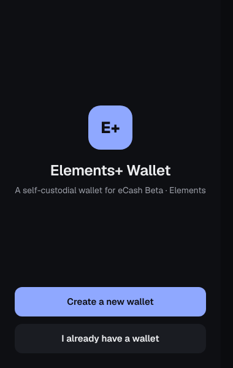
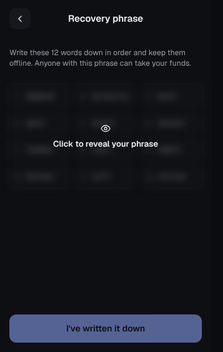
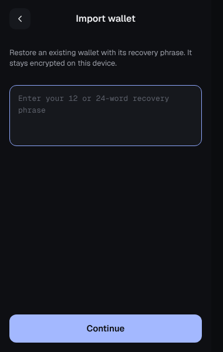
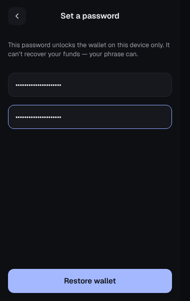
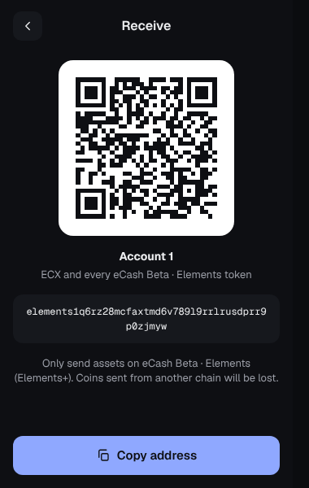

# Installing the Elements+ Wallet (testers)

This wallet is a browser extension for **eCash Beta · Elements** (betanet).
It is experimental: use it only with test funds.

You don't need to build anything. You'll download a zip file, unzip it, and
point your browser at the folder. It takes about five minutes.

Works in **Google Chrome, Brave and Microsoft Edge** (desktop). Firefox works
too, but forgets the wallet every time it restarts (see the end of this page).

## 1. Download

1. Open the project's **Releases** page on GitHub and pick the newest release.
2. Under **Assets**, download the file ending in **`-chromium.zip`**, for
   example `elementsplus-wallet-ecx-beta-v0.2.0-chromium.zip`.

## 2. Unzip it somewhere permanent

1. Make a folder you won't tidy away by accident, for example
   `Documents/Elements+ Wallet`.
2. Move the zip there and unzip it (Windows: right-click → **Extract All**;
   Mac: double-click the zip).
3. You now have a folder called **`elementsplus-wallet-ecx-beta`**.

**Leave this folder where it is.** The browser runs the wallet from it, and it
recognises the wallet by the folder's location. Moving, renaming or deleting
it breaks the wallet until you put it back.

## 3. Turn on developer mode

1. In the address bar, type `chrome://extensions` and press Enter.
   (In Brave it opens `brave://extensions`, in Edge go to `edge://extensions`.)
2. Switch on **Developer mode** (top right in Chrome and Brave; in the left
   sidebar in Edge). Three new buttons appear.

## 4. Load the wallet

1. Click **Load unpacked**.
2. Select the **`elementsplus-wallet-ecx-beta`** folder from step 2. Open the
   folder itself, not the zip and not the folder around it: the right folder
   contains a file called `manifest.json`.
3. **Elements+ Wallet — eCash Beta · Elements** appears in the list.

If you see an error saying the manifest file is missing, you picked the wrong
folder: try again one level deeper.

## 5. Pin it to the toolbar

1. Click the puzzle-piece icon (Extensions) to the right of the address bar.
2. Click the pin next to **Elements+ Wallet**.
3. The wallet's icon now stays in the toolbar. Click it to open the wallet.

## 6. Create or restore a wallet

When you open the wallet for the first time you'll see:

**New wallet: click "Create a new wallet".**

1. Click the blurred box to reveal your **12-word recovery phrase**.
2. Write the words down on paper, in order. This phrase is the only way
   to get your wallet back if you remove the extension, lose your password,
   or change computers. Anyone who has it can take your funds.
3. Click **I've written it down**, then type the words it asks for.
4. Choose a password and click **Create wallet**.

**Already have a phrase? Click "I already have a wallet".**

1. Type your 12- or 24-word recovery phrase and click **Continue**.
2. Choose a password and click **Restore wallet**.

The password only unlocks the wallet on this computer. It cannot recover
your funds; only the recovery phrase can.

## 7. Your address

Click **Receive** to see your address. It starts with `elements1`. This is
the address you give to faucets and to the DEX.

When a website such as the DEX asks to connect, a wallet window opens
showing the site's address. Approve only sites you expect. Every payment
opens its own window showing exactly what will be sent, and nothing is sent
until you approve it.

## Updating to a new release

Before updating, **make sure you have your recovery phrase written down**.
(Forgot it? Open the wallet → **Settings** → **Recovery phrase** and
enter your password.)

The wallet survives an update if the new files go into **the same folder,
with the same name, in the same place**:

1. Close the browser completely.
2. Download the new release's `-chromium.zip`.
3. Delete the old `elementsplus-wallet-ecx-beta` folder, then unzip the new zip
   in the same place. You get a fresh `elementsplus-wallet-ecx-beta` folder
   at the same location.
4. Open the browser and go to `chrome://extensions`. If the wallet shows an
   error, or isn't on the new version yet, click its reload button (↻).
   The version number is shown next to the wallet's name.
5. Open the wallet. It asks for your password as usual and still has your
   wallet.

Things that **lose the wallet on this browser** (your funds are safe, but you
will need your recovery phrase to restore it):

- clicking **Remove** on the extensions page, which deletes the wallet's data;
- loading the new release from a **different folder** with **Load unpacked**:
  the browser treats it as a separate, empty wallet. If this happens, remove
  the new copy and update the original folder as described above, or just
  restore from your phrase in the new copy.

## Messages you may see

- **A warning about developer mode extensions** when the browser starts:
  close it or click **Cancel**/**Keep**, never **Disable** or **Remove**. It
  appears for every extension loaded this way.
- **The wallet's icon is a grey letter "E".** That's expected; the extension
  has no icon yet.
- **"Couldn't reach the network"**: the betanet explorer is unreachable.
  Check your connection and click **Try again**.

## Firefox

Firefox only allows this kind of extension temporarily, and **removes it
whenever Firefox restarts**, along with the wallet on it. Only use Firefox if
you are comfortable restoring from your recovery phrase every time.

1. Download the file ending in **`-firefox.zip`** (don't unzip it).
2. Go to `about:debugging#/runtime/this-firefox`.
3. Click **Load Temporary Add-on…** and select the zip.
